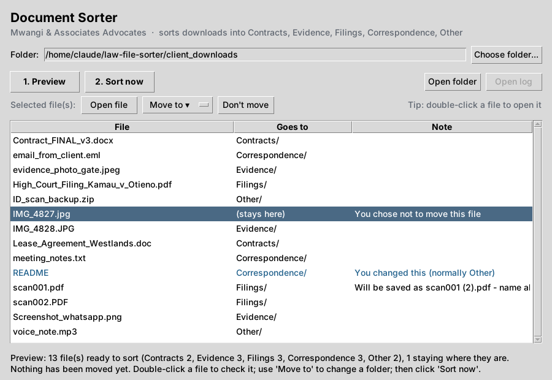
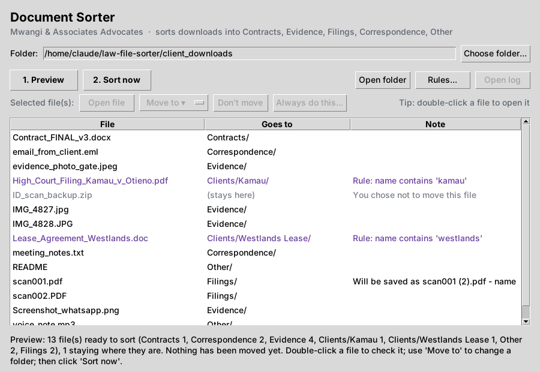
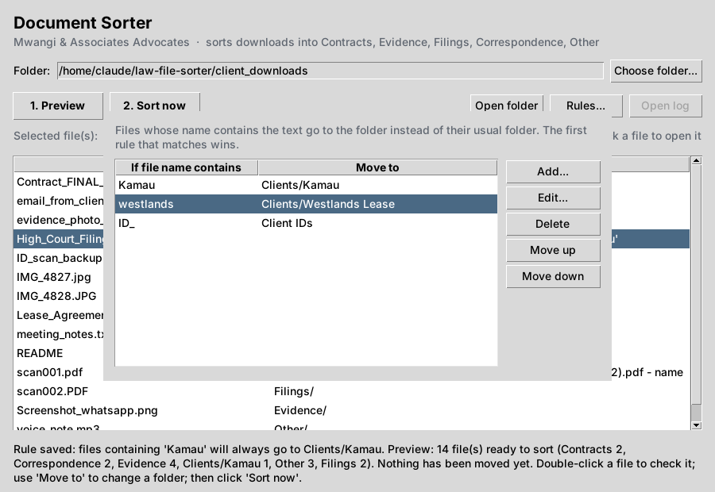
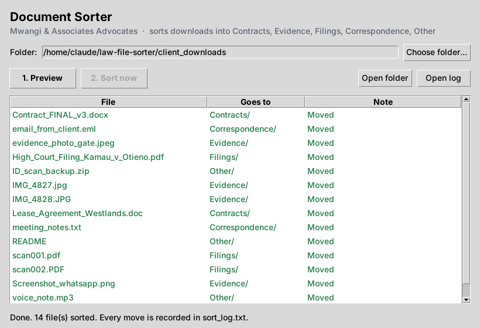

# Law Firm File Sorter

A Python tool that turns a messy downloads folder into an organised one in seconds. Built for a law firm on Moi Avenue, Nairobi, whose staff download client documents into one folder all day. By Friday it holds around 200 files with names like `scan001.pdf`, `IMG_4827.jpg` and `Contract_FINAL_v3.docx`.

AI Masterclass 2, Week 5, Day 21: file automation.

## What it does

It sorts every file in a folder into subfolders by type:

| Folder | File types |
|---|---|
| `Contracts/` | `.docx`, `.doc` |
| `Evidence/` | `.jpg`, `.jpeg`, `.png` |
| `Filings/` | `.pdf` |
| `Correspondence/` | `.txt`, `.eml` |
| `Other/` | everything else |

It also writes **every move to `sort_log.txt`**, with the timestamp, original path and new path, so the firm always knows where a document went.

## Built for client documents

- **Preview first.** By default the tool only *shows* what it would do. Files move only when you add `--apply`.
- **Never overwrites.** If `Filings/scan001.pdf` already exists, the new file is saved as `scan001 (2).pdf`.
- **Skips files in use.** If a document is open in Word or Acrobat, it's logged as failed and left in place, and the rest still get sorted. Word's temporary `~$` lock files are ignored.
- **Leaves existing subfolders alone,** and handles uppercase extensions like `.PDF` and `.JPG`.
- **Works fully offline.** No document leaves the computer, which matters for client confidentiality.

## Time saved, and pricing

**Time saved:** about **1.5–2 hours a week**. Sorting 200 files by hand (open or recognise the file, find the right folder, drag it, sometimes rename to avoid overwriting) takes around 30 seconds each, which is about 1.7 hours. That's before the time lost searching an unsorted folder for a specific contract during the week. Over a year, that's **75–100 hours** of staff time.

**Price:** **KES 8,000** to build and set it up. That covers:
- customising the folders to how the firm works (e.g. by client or case type),
- installing it on the office computer,
- scheduling it to run automatically every evening,
- a short training session.

Optional support is **KES 1,000 per month** for changes and new rules.

## Desktop app for office staff

Staff don't use the terminal. They use **Document Sorter**, a small Windows app: **Choose folder → 1. Preview → 2. Sort now**.

- **Preview first:** it shows where every file will go before anything moves.
- **Check a file:** double-click any file (or select it and click **Open file**) to open it in its normal program, e.g. to see what `IMG_4827.jpg` actually is before it's filed as Evidence.
- **Override the rules:** select one or more files and use **Move to ▾** to:
  - choose a different category (e.g. a scanned contract PDF to *Contracts* instead of *Filings*),
  - create a **New folder...**, e.g. a client's name like `Caleb Otieno` or `Clients/Jane Wanjiru`, which is created when sorting,
  - or **Choose another folder...** anywhere on the computer, e.g. `D:\Clients\Caleb Otieno`.

  Recently used folders appear in the menu for one-click filing. **Don't move** leaves files in place. Changed files show in blue and skipped files in grey. Folder names are checked first: Windows-invalid characters, reserved names like `CON`, and `..` are refused with a plain message.
- **Saved rules:** "any file whose name contains *Caleb* always goes to *Clients/Caleb Otieno*". Make one from a file with **Always do this...**, or manage them all in **Rules...** (add, edit, delete, reorder). Rule-matched files show in purple. The order of priority is: a choice made by hand in the preview, then saved rules (first match wins), then the file type.
- **After sorting:** sorted files turn green, and double-clicking opens the file in its new location. Buttons open the folder and the log, and it remembers the last folder used.






(Screenshots are from Linux. On Windows the app uses the native Windows look.)

`USER_GUIDE.md` is a one-page guide written for staff, to print and leave with the client.

### Build the .exe (so staff don't need Python)

On a Windows computer with Python installed, in this folder:
```bat
build_exe.bat
```
This creates `dist\Document Sorter.exe`, a single file. Copy it to the client's computer, put a shortcut on the desktop, and it runs without Python installed. To brand it for a client, change `FIRM_NAME` at the top of `sorter_app.py` before building.

Some antivirus programs flag new, unsigned `.exe` files. If Windows SmartScreen warns, click **More info → Run anyway**, or add an exception during setup.

## Setup (developers)

Python 3.8 or newer. No extra packages needed to run. `tkinter` comes with the standard Windows Python installer.

Run the app from source:
```bash
python sorter_app.py
```

## Command-line usage (for automation)

Preview what will happen (nothing is moved):
```bash
python sort_files.py "C:/Users/Reception/Downloads/Client Docs"
```

Sort the files:
```bash
python sort_files.py "C:/Users/Reception/Downloads/Client Docs" --apply
```

## Try it with dummy files

`make_test_folder.py` creates a `client_downloads` folder with 15 empty test files: mixed types, uppercase extensions, a Word lock file, and a name clash with an already-sorted file.
```bash
python make_test_folder.py
python sort_files.py client_downloads            # preview
python sort_files.py client_downloads --apply    # sort
```

Example output:
```
SORTING: 14 file(s) in client_downloads

  Contract_FINAL_v3.docx                   -> Contracts/Contract_FINAL_v3.docx
  email_from_client.eml                    -> Correspondence/email_from_client.eml
  evidence_photo_gate.jpeg                 -> Evidence/evidence_photo_gate.jpeg
  High_Court_Filing_Kamau_v_Otieno.pdf     -> Filings/High_Court_Filing_Kamau_v_Otieno.pdf
  ID_scan_backup.zip                       -> Other/ID_scan_backup.zip
  IMG_4827.jpg                             -> Evidence/IMG_4827.jpg
  IMG_4828.JPG                             -> Evidence/IMG_4828.JPG
  Lease_Agreement_Westlands.doc            -> Contracts/Lease_Agreement_Westlands.doc
  meeting_notes.txt                        -> Correspondence/meeting_notes.txt
  README                                   -> Other/README
  scan001.pdf                              -> Filings/scan001 (2).pdf  (renamed: a file with that name already exists)
  scan002.PDF                              -> Filings/scan002.PDF
  Screenshot_whatsapp.png                  -> Evidence/Screenshot_whatsapp.png
  voice_note.mp3                           -> Other/voice_note.mp3

Summary: Contracts 2, Correspondence 2, Evidence 4, Filings 3, Other 3
Logged to client_downloads/sort_log.txt
```

`sort_log.txt`:
```
--- Run started 2026-11-12 08:07:31: 14 moved, 0 failed ---
2026-11-12 08:07:31 | MOVED  | ...\client_downloads\Contract_FINAL_v3.docx -> ...\client_downloads\Contracts\Contract_FINAL_v3.docx
2026-11-12 08:07:31 | MOVED  | ...\client_downloads\scan001.pdf -> ...\client_downloads\Filings\scan001 (2).pdf
...
```

## Run it automatically every evening (Windows)

1. Open **Task Scheduler**, then click **Create Basic Task**.
2. Name it "Sort client documents" and set the trigger to **Daily** at 6:00 PM.
3. Choose **Start a program**:
   - **Program:** `python`
   - **Arguments:** `"C:\Tools\sort_files.py" "C:\Users\Reception\Downloads\Client Docs" --apply`

## Saved rules file

Rules are stored in `sorter_rules.json` **inside the folder being sorted**, so the desktop app, the command line and the scheduled nightly run all use the same rules. The sorter never moves this file itself. Example:
```json
[
  {"contains": "Kamau", "folder": "Clients/Kamau"},
  {"contains": "westlands", "folder": "Clients/Westlands Lease"},
  {"contains": "ID_", "folder": "D:/Client IDs"}
]
```
`folder` can be inside the sorted folder (e.g. `Clients/Kamau`) or anywhere on the computer (e.g. `D:/Client IDs`). If the file is damaged, the sorter ignores it, shows a warning, and falls back to sorting by file type.

## Customising

Edit `CATEGORIES` at the top of `sort_files.py` to add folders or file types, e.g. `"Invoices": {".xlsx", ".xls"}`.
